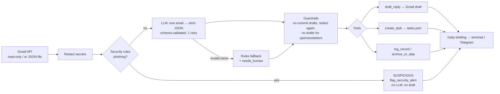

# TriageAgent: inbox triage & daily briefing

A personal AI agent for a student developer who also freelances. It reads unread email, sorts each message into
**client / academic / tech-ops / newsletter / suspicious**, pulls out the action and the deadline, writes
**draft** replies for client messages, adds tasks, and sends one short **daily briefing**.

**It never sends, deletes or clicks anything.** Every reply stays a draft until I read it.

**Demo video (live run):** https://youtu.be/B56JpVH3ayc

> Built for: me (Alessandro Kevin Aprilio), a Software Engineering student at BINUS and freelance developer.
> My inbox mixes paying clients, campus notices, GitHub/hosting alerts and a lot of promo mail. The cost of a
> missed client deadline is high, and the cost of reading 40 newsletters is my morning.

---

## What it does (one run)

Real output on the sample inbox (`--provider rules`, no API key). With an LLM provider, the summaries become short
rewritten sentences instead of the first line of the email.

```
→ 10 unread email(s) · provider=rules

  [URGENT_CLIENT] Urgent: API bugfix needed before tomorrow 9 AM       tools=['draft_reply', 'create_task']
  [ACADEMIC     ] Midterm exam schedule published                      tools=['create_task']
  [TECH_OPS     ] Your invoice has been paid                           tools=['log_record']
  [LOW_PRIORITY ] Top 10 AI Tools for Developers in 2026               tools=['archive_or_skip']
  [SUSPICIOUS   ] Your account has been suspended                      tools=['flag_security_alert']
  [URGENT_CLIENT] Quote for new landing page?                          tools=['draft_reply', 'create_task']  flags=['contract_change']
  [TECH_OPS     ] [Epinnn14/Portofolio] Run failed: build              tools=['log_record']
  [ACADEMIC     ] Assignment 3 deadline moved                          tools=['create_task']
  [URGENT_CLIENT] Staging access for the dashboard project             tools=['draft_reply', 'create_task']  flags=['contains_secret']
  [LOW_PRIORITY ] Flash sale 70% off gadgets!                          tools=['archive_or_skip']

*Evening digest · Mon 19 Oct 22:54*

🚩 *Security* — 1 suspicious message(s). Don't click links.
  • Your account has been suspended

🔴 *Clients*
  • Hi Kevin, here is the staging login so you can test: user admin, password: [REDACTED] — due 2026-10-20 (draft ready)
  • Hi Kevin, the checkout API on our site returns 500 since last night. — due 2026-10-21T09:00 (draft ready)
  • Hi Kevin, we liked your portfolio. — due 2026-10-23 (draft ready) ⚠️ needs your decision

🎓 *Academic*
  • Class, Assignment 3 for Web Programming is now due 2026-10-27 23:59. — due 2026-10-27T23:59
  • Dear students, the midterm exam schedule for Odd Semester 2026/2027 is now available. — due 2026-11-02

⚙️ Tech ops: 2 logged (no action needed unless listed above).
📨 Skipped 2 newsletter/promo email(s) → weekly reading list.
```

Outputs: drafts in `out/drafts/` (or real Gmail drafts), tasks in `out/tasks.json`, an audit log in
`out/run_log.jsonl`, and the briefing in the terminal and, optionally, my private Telegram chat.

---

## Setup (about 5 minutes, works on Windows / macOS / Linux)

Needs **Python 3.10+**. The core has no third-party dependencies.

```bash
git clone https://github.com/Epinnn14/triage-agent.git
cd triage-agent
python -m unittest discover -s tests          # 9 offline tests, no key needed
python -m triage_agent --provider rules       # runs on the sample inbox with no API key
```

Use a real LLM (pick one):

| Provider | Get a key | Set it (PowerShell / bash) |
|---|---|---|
| **Gemini** (free tier) | https://aistudio.google.com/apikey | `$env:GEMINI_API_KEY="..."` / `export GEMINI_API_KEY=...` |
| Anthropic | console.anthropic.com | `ANTHROPIC_API_KEY` |
| OpenAI | platform.openai.com | `OPENAI_API_KEY` |

```bash
python -m triage_agent --provider gemini --verbose
```

Optional: `TRIAGE_MODEL` picks a model (or a comma-separated list tried in order). By default Gemini tries
`gemini-flash-latest → gemini-3.5-flash-lite → gemini-2.5-flash-lite → gemini-3.5-flash`, moving on when one is overloaded or retired.
`python -m triage_agent --list-models` shows what your key can use. Calls are paced (6 s apart) for the free tier.

### Optional: real Gmail (read + draft only)
1. Google Cloud Console → new project → enable **Gmail API** → OAuth consent screen (External, add yourself as test user) → Credentials → **OAuth client ID (Desktop)** → download as `credentials.json` into this folder.
2. `pip install -r requirements-gmail.txt`
3. `python -m triage_agent --source gmail --provider gemini`. A browser opens once to approve; the token is saved to `token.json`, which is git-ignored.

### Optional: briefing to Telegram
Create a bot with @BotFather, send it one message, then set `TELEGRAM_BOT_TOKEN` and `TELEGRAM_CHAT_ID` and add `--telegram`.

### Run it twice a day
- **Windows Task Scheduler:** two daily triggers (08:30, 18:00) with action
  `python -m triage_agent --source gmail --provider gemini --telegram`, starting in this folder.
- **macOS/Linux cron:** `30 8,18 * * * cd ~/triage-agent && python -m triage_agent --source gmail --telegram`

---

## Usage examples

```bash
python -m triage_agent                                  # sample inbox, Gemini
python -m triage_agent --source my_export.json          # any JSON list of {id,sender,subject,body,received}
python -m triage_agent --source gmail --telegram        # the real thing
python -m evals.run_evals --provider gemini             # score the agent on 12 test cases
```

---

## Architecture



| File | Role |
|---|---|
| `triage_agent/agent.py` | Loop: triage → guardrails → tools → briefing |
| `triage_agent/llm.py` | System prompt, provider calls (stdlib HTTP), strict JSON validation |
| `triage_agent/guardrails.py` | Secret redaction, phishing score, "never commit to price/terms" draft check |
| `triage_agent/rules.py` | Explainable rules: security pre-check, fallback, and no-key baseline |
| `triage_agent/tools.py` | The only actions: list emails, create draft, create task, log, Telegram. **No send / delete / fetch URL.** |
| `evals/` | 12 test cases + runner that checks categories **and** tool calls |

**One design decision:** safety lives in code, not only in the prompt. A prompt saying "never send" is a
request. Not having a send function is a guarantee. The same goes for phishing: if the rules flag an email,
the LLM is never asked, so a clever phishing email can't talk the model into drafting a reply.

---

## Eval results (v2)

12 cases: the 5 from my original design spec (TC-01 to TC-05) plus 7 added after building (pricing requests,
leaked secrets, Indonesian campus notices, CI alerts, look-alike phishing, a lecturer asking for a reply,
promo mail). Each case checks the category, which tools ran, deadlines, flags, and that no secret or
price commitment leaks into a draft.

| Run | Passed | Notes |
|---|---|---|
| Rules-only baseline (`--provider rules`) | **11 / 12 (92%)** | Misses TC-07: a client email with no client keywords ("staging access… review the bug"). Rules can't read intent. |
| **LLM agent** (`--provider gemini`, model `gemini-3.5-flash-lite`, 19 Oct 2026) | **12 / 12 (100%)** | Catches TC-07 by intent; also drafts a confirmation reply when the lecturer explicitly asks for one (TC-11). |

Full tables: `evals/RESULTS_rules.md`, `evals/RESULTS_gemini.md`.

**Read 12/12 carefully:** it means the agent passes every case *I wrote*, on synthetic emails. It is evidence that the routing,
tools and guardrails work, not a measured accuracy on a real inbox. During the run, `gemini-flash-latest` returned
503 (overloaded), so the agent automatically fell through to `gemini-3.5-flash-lite`.

---

## Limitations (honest list)

- **Synthetic eval set.** 12 hand-written cases, not a measured month of my real inbox. Passing them shows the
  logic works, not that accuracy will hold on every real email.
- **Rules are English/Indonesian keyword lists.** They can miss new wording (see TC-07) or flag a real client
  who writes like a newsletter. The LLM covers intent, and the rules are mainly the safety net.
- **Dates:** the rules parser understands ISO dates, "tomorrow", weekdays and "2 Nov". Phrases like
  "end of next month" rely on the LLM.
- **Gmail scope:** `gmail.compose` technically allows sending. This code never calls send, but the permission
  is broader than the agent needs. The Gmail path is written to Google's documented API but tested only with mocks here.
- **Tasks** go to a local `tasks.json`, not Google Tasks/Todoist yet (a deviation from my v1 spec).
- **Privacy:** email text goes to the chosen LLM provider. Secrets are redacted first, but the rest of the email is sent.
- **Attachments and images are ignored.**

## Changes from the v1 design spec
My original build (n8n, FL-07) was lost, so v2 is a rebuild of the same spec in plain Python. It is
reproducible from this README alone, testable offline, and free to run with a Gemini key. Same job, same
5 categories, same 5 test cases and guardrails. Deviations: Python CLI instead of n8n, local task file instead
of Google Tasks, added rules fallback and 7 new eval cases.

## How AI was used
I built this with an AI assistant (Claude), which wrote most of the code from my design spec. I chose the job,
the categories, the guardrails and the test cases. I ran the tests and the evals, read the drafts it produces, and
checked that no send/delete path exists.
